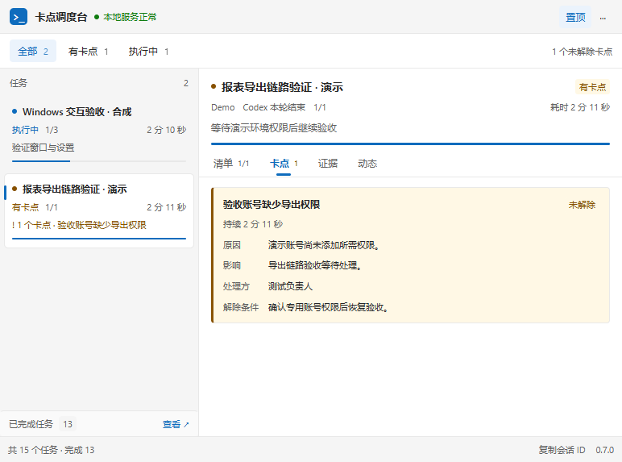
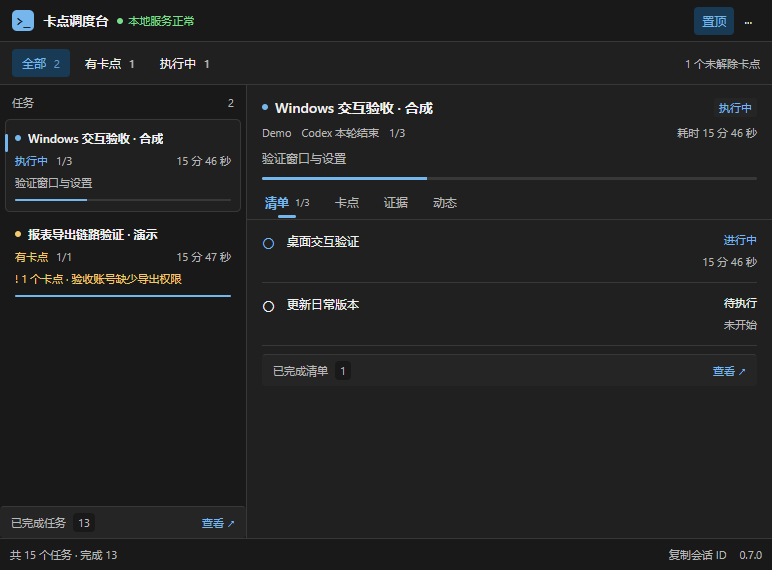
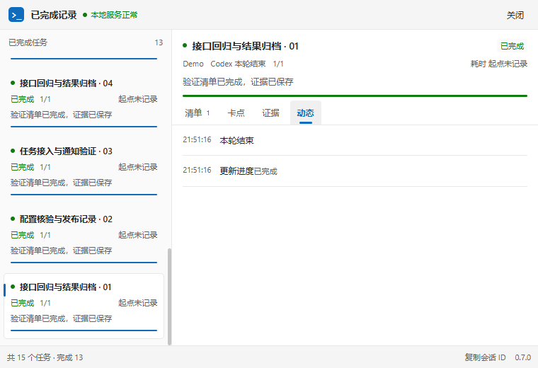
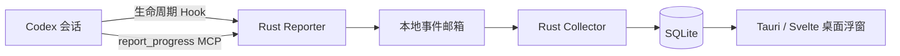

<div align="center">

# Codex Task · 卡点调度台

**在一个桌面浮窗里，查看多个 Codex 会话的进度、卡点和验收证据。**

[](https://github.com/Memento1990/codex-task/releases/latest)
[](LICENSE)


[下载](https://github.com/Memento1990/codex-task/releases/latest) · [快速开始](#快速开始) · [功能](#功能) · [源码构建](#源码构建) · [更新记录](CHANGELOG.md) · [反馈](https://github.com/Memento1990/codex-task/issues)

</div>



> 独立的社区工具，与 OpenAI 无隶属关系。当前发布 Windows x64 版本；截图来自真实 Windows WebView2 界面，全部使用隔离的合成演示数据。

## 为什么做这个工具

同时推进多个 Codex 会话时，任务是否仍在执行、哪一步受阻、需要谁处理，容易散落在不同聊天里。卡点调度台通过生命周期 Hook 和结构化 MCP 汇报，将这些状态集中显示在桌面上。

它保留“本轮对话结束”和“任务验收完成”的区别，也保留卡点的原因、影响、处理方与解除条件，方便决定下一步关注哪个会话。

## 功能

| 功能 | 当前能力 |
| --- | --- |
| 多会话汇总 | 全部 / 有卡点 / 执行中筛选，任务进度和当前步骤 |
| 结构化清单 | 待执行、进行中、受阻、已完成，以及步骤备注 |
| 卡点详情 | 原因、影响、处理方、解除条件及持续时间 |
| 验收证据 | 查看验收引用、打开受支持的文件或网页；不保存动态流水 |
| 耗时 | 任务、清单项和卡点独立计时，完成后冻结，恢复后累计 |
| 完成记录 | 独立二级窗口查看已完成任务和清单，主窗口保持紧凑 |
| 桌面通知 | 状态变化通知、不抢焦点、悬停暂停、点击定位任务 |
| 窗口与主题 | 置顶、托盘、黑白主题、详情折叠、贴边头像球与可配置摘要 |
| 一键接入 | Codex 配置预检、备份、差异预览和按条目撤销 |
| 本地数据 | SQLite 存储，离线积压补采，不启动本工具的 HTTP 服务 |

### 深色主题



### 完成记录



## 快速开始

### 1. 下载并启动

当前版本为 **0.9.0**，增加GitHub Release签名更新；版本内容见[0.9.0说明](docs/releases/v0.9.0.md)，设计、配置与维护流程见[自动更新说明](docs/automatic-updates.md)。从0.8.1升级需先手动下载一次新版便携包，之后可在应用内检查、下载并确认安装更新。

从 [Releases](https://github.com/Memento1990/codex-task/releases/latest) 下载 `CodexFloatboard-0.9.0-windows-x64.zip`，完整解压后运行：

```text
CodexFloatboard/
├── CodexFloatboard.exe
├── FloatboardUpdater.exe
├── current.json
├── README.txt
└── versions/
    └── 0.9.0/
        ├── CodexFloatboard.exe
        ├── FloatboardReporter.exe
        ├── FloatboardUpdater.exe
        ├── README.txt
        ├── THIRD-PARTY-NOTICES.txt
        └── LICENSE
```

保持完整目录结构，运行根目录的固定启动入口，不要直接为versions里的GUI建立快捷方式。使用阶段不需要安装 Node.js、Python 或 Rust；系统需要 Microsoft Edge WebView2 Runtime 和 Microsoft Visual C++ x64 运行库。更新清单已使用Ed25519签名；Windows EXE尚无Authenticode代码签名，无安装器。

可使用下载页的 `SHA256SUMS.txt` 核对 ZIP：

```powershell
Get-FileHash .\CodexFloatboard-0.9.0-windows-x64.zip -Algorithm SHA256
```

### 正式使用与本地开发隔离

本机推荐将GitHub完整便携包安装至用户LOCALAPPDATA/Programs/CodexFloatboard。日常使用正式版固定启动器，开发产物不得拷入该目录。开发GUI使用 `app/desktop` 下的 `pnpm dev:isolated`，独立数据、Codex配置和WebView，带DEV标识且禁用正式更新/系统自启。开发完成先发布GitHub新版，再让正式版确认更新。详见[开发隔离说明](docs/development-isolation.md)。

### 2. 连接 Codex

1. 在浮窗中打开 **··· → Codex 接入**。
2. 点击 **连接 Codex**。默认接入会在当前用户目录安装小型 Rust 连接组件，预检并备份配置，不需要管理员权限，不修改你的项目。若发现旧版连接，按预览确认恢复或升级；陌生冲突不会覆盖。
3. 按 Codex 原生界面的提示启用与信任连接。方便时使用 Codex 的重载功能，或完整退出并重启 Desktop；仅新建标签页可能仍复用旧进程。有正在进行的工作可点 **稍后完成**，看板不会结束 Codex。
4. 在会话中开始一个多步骤任务。接入向导会依次显示 **等待载入 → 已收到当前会话 → 任务同步已验证**，无需再编辑配置或运行脚本。

配置准备好、本地预检通过或历史 Hook 曾成功，都不代表本次同步已通。只有当前连接的真实结构化报告入库后才显示“同步已验证”；没有业务任务不视为失败。已有会话不会追溯导入历史清单。

默认新链路需要支持 MCP-tool Hook 的 Codex；本轮实际验证为 **Codex Desktop 0.166.0-alpha.5.1**。旧版本能力不作保证，建议升级 Codex 后连接。默认数据目录（及其迁移目标）使用固定入口；显式自定义 `--data-dir` / `CODEX_FLOATBOARD_DATA` 的独立便携实例保留旧命令接入模式，不享有全部固定入口能力。

**高级选项**可查看本工具配置差异。接入写入当前 Windows 用户的 `CODEX_HOME/config.toml`，默认是 `%USERPROFILE%\.codex\config.toml`；不改其他连接或全局审批策略，也不代写 Hook 信任记录。

### 3. 日常使用

- 主窗按任务切换清单、卡点、证据和动态；有问题时使用“有卡点”筛选。
- 默认窗口 772 × 570，最小 392 × 570；宽窗左右分栏，窄窗上下排列。
- 使用无系统标题栏的内部工具栏：空白标题区可拖动，双击最大化 / 还原；右上角依次提供置顶、更多、最小化、最大化 / 还原、关闭。
- 点击右上角关闭按钮会隐藏到托盘；从菜单退出看板不会终止 Codex 或采集器。
- 从设置调整主题、任务栏显示、开机自启和通知；自启默认关闭，通知默认开启。连续点击“测试通知”会叠加独立预览，最多保留最新 4 条。
- 数据目录入口已移入设置，可打开当前目录或执行离线迁移，详见下文。
- 从主窗底部进入完成记录；复制会话 ID 后在 Codex 中手动定位对话。

## 状态与使用边界

| 状态 | 含义 |
| --- | --- |
| 执行中 | 已汇报任务仍在推进 |
| 有卡点 | 任务受阻，并记录了开放卡点 |
| 待确认 | 任务正在等待输入或确认 |
| 已完成 | 清单全完成、有验收证据，且没有开放卡点 |
| 未汇报 | 尚未收到结构化进度，不从工具日志猜测业务清单 |

Hook 的 `Stop` / `SessionEnd` 只更新运行状态，不直接把业务任务标为完成。耗时是按报告还原的自然经过时间，包含等待和受阻，不等于模型活跃工时。

“调度台”目前指集中查看和分流关注：**尚不支持向其他会话派发指令、自动解除卡点、审批操作或自动恢复任务**。当前使用复制会话 ID 定位，不承诺桌面深链跳转。真实子 Agent 路由、WSL Linux CLI、macOS 和 Linux 尚未完成实际验收。

## 数据与隐私

数据默认保存在：

```text
%LOCALAPPDATA%\CodexFloatboard\data
```

- 本工具不启动网络服务、不把任务数据上传到本工具服务器；打开外部证据链接、使用 Codex 本身仍可能访问网络。
- Hook 事件只保留需要的运行元数据，原始提示词、命令和工具输出不进入事件库。
- 结构化汇报仍可能包含你或模型主动填写的内容；敏感值过滤仅作尽力处理，不能代替内容审查。
- 配置备份可能包含原配置中的敏感项，只在本机保存。**不要分享整个数据目录或配置备份。**
- 采集器离线时事件暂存在 `inbox/`，恢复后补采；异常事件隔离在 `rejected/`。
- 断开连接时，在接入窗口的高级选项中选择 **断开连接…**；仅撤销仍属于本工具的条目，不删除任务数据。

安全问题请参阅 [SECURITY.md](SECURITY.md)。

### 迁移数据目录

迁移是**离线复制与切换**，不是在线热迁移：

1. 先在 **更多 → Codex 接入** 用当前新版重新连接，正常完成新版 Hook 信任；旧版接入记录会阻止迁移。
2. **完整退出所有 Codex / app-server 会话及其他看板实例，暂停全部上报**。不要在有未保存工作时强制结束进程；旧版 Hook 仍会读取旧数据库，不能与迁移后的目录混用。
3. 在 **设置 → 数据目录** 输入一个本地绝对路径，目标必须为空且不能与旧目录嵌套，不支持 UNC、符号链接或 junction。
4. 阅读并确认已暂停生产者后迁移。工具与新版采集器握手暂停写库，用 SQLite 一致性快照复制数据库，复制设置和会话，再原子切换路径；旧库保留。旧采集器不支持安全暂停时会拒绝迁移，不会强制终止它。
5. 点击 **重启并使用新目录**，再启动 Codex 并确认加载新版 Hook / MCP。**保留旧目录及其中的重定向文件，不要删除**；默认启动和仍携带旧路径的新版入口需要通过它找到新目录。

失败时旧目录仍为权威来源；部分复制的目标目录会保留，确认后改用另一个空目录重试。旧目录是迁移时的备份，不会持续同步成完整副本，不能直接用它回退覆盖新数据。本工具不承诺旧版 Reporter 在迁移后继续无损工作。

## 工作原理



Hook 提供运行事件，MCP 提供业务清单、卡点和证据；两者分别存储和呈现。窗口、采集器和 Codex 会话相互独立，避免关闭浮窗影响正在执行的任务。

## 源码构建

### 环境

当前验证环境：Windows x64、Node.js 22.11、pnpm 10.32、Rust 1.94（MSVC 工具链）、Visual Studio C++ Build Tools 2022、Windows 10/11 SDK、WebView2。

请在已加载 C++ 工具链的 **Developer PowerShell for VS 2022** 中运行：

```powershell
git clone https://github.com/Memento1990/codex-task.git
cd codex-task
pnpm --dir app/desktop install --frozen-lockfile

# 模型测试、类型检查与前端生产构建
pnpm --dir app/desktop test
pnpm --dir app/desktop build

# Rust 核心、兼容与进程测试
cargo test --manifest-path app/desktop/reporter/Cargo.toml --locked

# 构建 Reporter 和桌面宿主
cargo build --manifest-path app/desktop/reporter/Cargo.toml --release --locked
Push-Location app/desktop
pnpm tauri build --no-bundle
Pop-Location
```

构建完成后，默认未配置外部 target 时，将以下两个文件复制到同一目录：

```text
app/desktop/src-tauri/target/release/CodexFloatboard.exe
app/desktop/reporter/target/release/FloatboardReporter.exe
```

若设置了 `CARGO_TARGET_DIR` 或 Cargo `build.target-dir`，以上路径会改变。分别运行 `cargo metadata --manifest-path app/desktop/reporter/Cargo.toml --no-deps --format-version 1 --locked` 和宿主 manifest 的同类命令，以 `target_directory` 为准，再从其 `release` 子目录取包。本机按项目划分的外部 target 与 sccache 配置见 [应用说明](app/README.md#本机产物与编译缓存)。

前端布局开发可运行 `pnpm --dir app/desktop dev`。普通浏览器没有原生桥接能力，完整接入、托盘和通知需通过 `pnpm --dir app/desktop tauri dev` 验证。

`app/desktop/build-native.ps1` 是作者本机便携工具链的辅助脚本；新机器请使用上述标准工具链命令。不要把本机 C++ 工具链或编译缓存提交到仓库。

### 目录

```text
app/
├── desktop/
│   ├── src/             # Svelte / TypeScript 界面
│   ├── src-tauri/       # Rust 原生宿主、托盘和窗口
│   ├── reporter/        # Rust Hook / MCP / 采集 / SQLite
│   └── tests/           # 前端模型与原生交互脚本
└── README.md            # 应用源码导航
docs/
├── images/              # 合成数据的产品截图
└── releases/            # 发版说明和公开验收摘要
```

当前源码仅保留 Tauri / Svelte / Rust 实现。旧 Python / Qt 实现及其专属测试和打包脚本已移除，可从 Git 历史查阅；Rust 兼容测试仍保留所需的合成数据库与快照夹具，不需要 Python 环境。本机任务库、凭据、原始验收记录、历史构建包和依赖缓存由 `.gitignore` 排除。

## 常见问题

<details>
<summary>窗口显示服务正常，为什么没有任务？</summary>

采集器健康不等于已收到 Hook，更不等于已收到业务汇报。先打开接入面板的连接诊断：没有 Hook 时完整退出并重启 Codex Desktop / CLI，确认新版 Hook 已启用并正常信任；已有 Hook 但显示未汇报时，确认当前会话加载了 MCP 并开始多步骤任务。短问答可以不建立清单。

本机排查发现旧 app-server 可能早于配置修改；仅新标签不一定刷新。当前磁盘上的 9 个 Hook 在 Codex 0.165 中可正确解析为已启用、已信任，但已有正式会话是否因重启恢复仍需用户方便时验证，不能仅凭配置就声称链路已通。
</details>

<details>
<summary>旧会话还在使用旧 Reporter，需要结束任务吗？</summary>

不需要。旧 MCP 进程继续写入兼容事件邮箱；新配置加载后再使用新版。旧会话未结束前保留其依赖的旧程序目录。
</details>

<details>
<summary>关闭浮窗后任务会停止吗？</summary>

不会。关闭按钮隐藏到托盘，退出看板也不终止 Codex。通知仅在 GUI 运行时显示。
</details>

<details>
<summary>如何卸载或回退？</summary>

先在接入设置中断开连接，按需关闭本工具自启，再退出窗口。保留数据备份后可删除程序目录。回退兼容版本时不删除任务库，也不要用旧配置备份覆盖后来新增的其他配置。
</details>

## 参与贡献

欢迎提交问题和改进建议。报告问题时注明版本、Windows / Codex 环境、复现步骤及脱敏截图；提交代码前请阅读 [CONTRIBUTING.md](CONTRIBUTING.md)。

## 许可证

本项目采用 [MIT License](LICENSE)。第三方依赖保留各自的许可证与版权声明，便携包附第三方许可清单。
