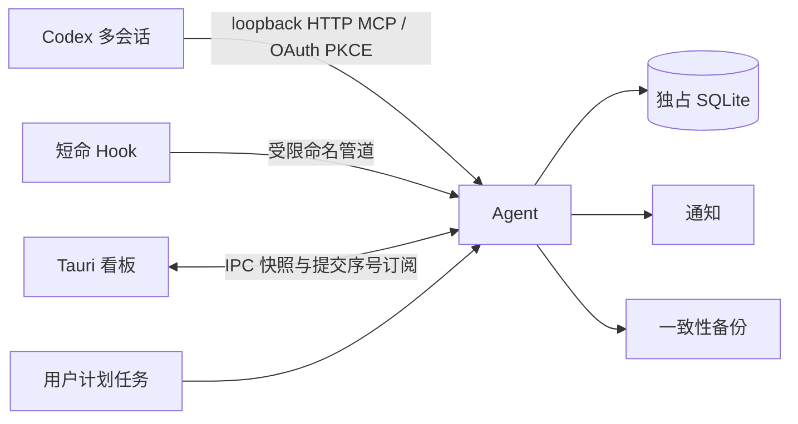

# 单 Agent 运行时与存储实施契约

批准日期：2026-11-06；当前候选：2.0.0。实施和隔离验收已获授权；正式安装、正式数据切换、提交和发布属于后续步骤。当前事实及未通过项见 [验收报告](../../artifacts/agent-runtime-20261109/acceptance.md)。

## 根因与目标

旧安装现场出现不同主库共用 WAL/SHM，且每会话产生 Bridge/Reporter、多个入口分别管理 worker。保留 Rust、Tauri/Svelte、SQLite，统一实际数据所有权和生命周期。新架构消除此故障机制；备份、完整性检查和磁盘异常处理仍保留。

## 所有权与依赖

protocol 只保留领域校验和协议。client 不依赖 SQLite，提供 SID/KnownFolder、IPC、短命 Hook 和计划任务。GUI 依赖 client/shell；shell 不依赖 SQLite。agent 独占业务库，storage 只由 Agent/离线维护使用。没有默认 stdio Bridge、Reporter、inbox、分散 worker 或客户端持久队列。

正式根为 Windows KnownFolder 用户目录下 .codex-floatboard/profiles/<UUID>；DEV 固定在官方 wrapper 沙箱。全局单实例键为当前 SID＋profile UUID，所有在线/离线数据库访问争用同一互斥权。程序路径、主库、WAL/SHM 的物理身份和数据库 marker 均验证，拒绝链接、替换、主库缺失及不配套身份。

## 提交与协议

协议和 schema 均为 2。串行存储执行器、128 项请求上限、背压、WAL、FULL。业务事件、投影、完成档案、计时、通知 outbox、提交序号和 report 回执同事务提交。

accepted=true 只表示已提交。回执包含 event_id/revision/commit_sequence，重试不会混入变化的 Agent 实例 ID。同会话同 revision 内容一致返回原回执；不一致拒绝，过期 revision 返回当前 revision。存储读取错误不得转成 -1 修订或空任务。

identity/snapshot 包含 profile、环境、Agent/数据库身份、协议/schema、真实存储状态和提交序号。watch 在存储执行器之外等待提交变化，不阻塞写入；客户端始终用完整快照重新同步，断连、序号跳变、身份变化均不依赖本地增量。相同数据库序号倒退明确拒绝。

设置使用请求 ID＋settings_revision，响应丢失查询 command receipt。查询失败保持未确认状态；明确失败恢复已确认值。原生窗口副作用失败与数据库设置提交成功分开显示。

HTTP MCP 使用 rmcp Streamable HTTP，仅 loopback，稳定登记端口，冲突明确失败。OAuth 授权码＋S256 PKCE，明确本地配对，令牌绑定 profile、可刷新撤销，DPAPI 保存。实际 Desktop Codex 测试优先于工具发现或仅 Bearer 实验。

## 生命周期、计时和通知

正式 Agent 使用当前用户 InteractiveToken 计划任务，无密码、无 LocalSystem；登录启动后台，auto_start 设置仅控制看板自动打开。GUI/Hook/MCP 不启动其他版本后台；GUI 可运行已登记任务。关闭 GUI 后采集和已启用外部通知继续。显式停止依次停止接收、排空、提交、关闭数据库，正常退出码 0。

故障恢复由同一任务的一分钟重复触发实现，健康时 IgnoreNew，不新增常驻进程。正常停止意图绑定登录 AuthenticationId，同次登录的定时触发不重开数据库；显式请求运行或下次登录恢复。该实现替换了本机实测不生效的 RestartOnFailure，证据保留在 scheduler 对照日志和真实 Agent 恢复测试中。

重启/睡眠冻结累计时间，使用最后心跳或业务证据，不补造缺失时间；保持 partial。Hook 失败有限时且不阻断工作，不伪报接受。GUI 断连保留内存快照；新打开不可用则显示失联。

通知事件和 outbox 在业务事务内生成，发送在事务外，认领和结果持久化。未知结果或发送中断不自动/手动重发该条；明确暂时失败按 5/30 秒、最多三次重试。30 分钟有效期，记录 7 天/500 条；迁移不群发。凭据 DPAPI，不进入日志、诊断或产品错误原文。微信网络动作只在配置事务提交后执行。

## 历史、维护与安装

全部来源先哈希、复制后 SQLite 检查，保留原主库及 WAL/SHM。事件、原始任务快照、完成档案分别合并；同 ID/内容去重，修订链合并，业务冲突逐项决议。全部版本写入 provenance，不按修改时间选赢家。缺失/精简/不可读来源和修订缺口单独列出。

用户已确认的唯一冲突：相同任务 revision=1 业务一致、运行时间相差约 53 秒，保留两侧全部版本和来源，迁入 runtime=unknown，runtime_at/updated_at=null。该规则只接受运行态差异，不适用于业务内容冲突。

窗口、偏好、通知和微信密文通过显式 state_sources 离线迁移，全部版本进入 provenance，差异须决议。未确认发送转 unknown，启用前保持 paused 且不发送；不复制正式凭据到隔离环境。

原始历史基线 22,540 events / 39 tasks / 25 completed_tasks；最终可见数与原始任务数分别报告。迁移目标默认 paused，完整性、投影、来源哈希和决议摘要通过后才可启用。恢复只写全新目标并换数据库身份。

Agent 使用 SQLite backup API。每日有业务变化时备份，保留 14 份 daily；manual/upgrade/历史备份不自动删除。离线维护先确认 Agent 停止并取得同一互斥权。

专用入口为 migration-install.ps1＋FloatboardInstaller/Maintenance。先签名验证、预览旧实例/自启/owned 接入；旧会话正常退出后抓取最终来源；逐项决议并迁入；停写、备份、正常停止、同互斥校验、登记计划任务、切 owned 接入。新库保持 paused，实际 GUI 和 OAuth 往返完成后才 activate。journal 可续跑，不双写、不自动降级或回退旧库。

旧修复窗口、抢救、在线搬库、重定向、切库重启及专用依赖/测试删除。只保留事故证据，不保留兼容旧运行时的过渡入口。

## 验收映射

| 阶段 | 实现 | 验收 |
|---|---|---|
| 1 基线/契约 | 本文、源码 inventory | revision、dirty、边界与功能映射 |
| 2 接入/身份 | auth/transport/client | 实际 Desktop Codex OAuth、多会话、刷新撤销、跨 profile |
| 3 存储/通知 | storage actor/outbox/backup | 崩溃、冲突、回执、满盘、权限、损坏、备份 14 份、本地通知 |
| 4 客户端 | Engine/GUI/Hook/watch | 无 SQLite 依赖、失联保留、设置结果、工具窗、冻结 A |
| 5 迁移/维护 | Maintenance/provenance | 六来源逐项覆盖、冲突未知、原件哈希、Agent 读取、恢复新目标 |
| 6 安装更新 | signed stage/durable journal | 各阶段中断、无双写、配置保留、真实 GUI/OAuth 激活、计划任务 |
| 7 删除/整体验收 | 静态清理/文档/包 | 无旧入口、真实进程、独立 Desktop、签名资产和清理报告 |

实际执行结果以带日志、退出码和资源归属的验收报告为准，不以实现清单代替通过证据。
